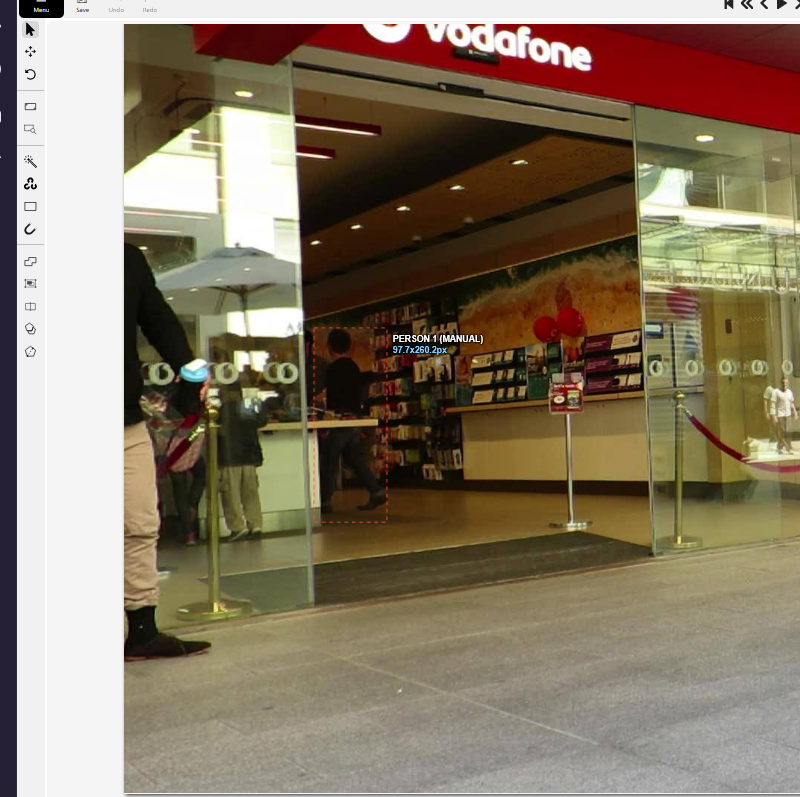
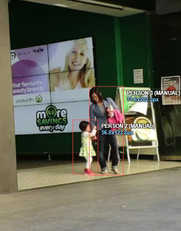
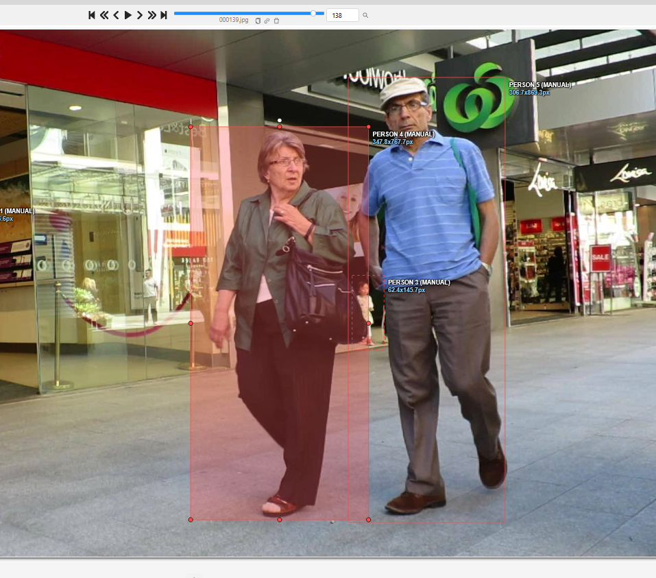

# Báo cáo cá nhân — TranThoLam-2A202603025

Đổi tên file theo quy tắc `MSSV_HoTen.md`. Ví dụ: `20241234_NguyenVanAn.md`.

Đoạn video: MOT17-09, 150 frame (frame 1–150), nguồn MOTChallenge, giấy phép CC BY-NC-SA 3.0.

## 0. Thông tin học viên

- Họ tên: Trần Thọ Lâm
- MSSV: 2A202603025
- Mã đề (A/B/C): B
- Email: Trantholam29@gmail.com
- Link repository: https://github.com/LamChan2k4/K5-L2-DAY05-TranThoLam-2A202603025-MOTTracking
- Giờ bắt đầu: 17:00 (13/11/2026)
- Giờ kết thúc: 12:00 (14/11/2026)

## 1. Xem trước đoạn video (CP0)

Ghi **trước khi vẽ**, mỗi người một dòng.

| Mã | Frame xuất hiện | Frame cuối thấy được | Rẽ / dừng / đổi tốc độ ở frame | Bị che ở frame | Ghi chú |
|---|---|---|---|---|---|
| P1 | 0 | 149 | Chậm/dừng nhẹ quanh frame 20–25 và 89–103; đổi hướng nhẹ đoạn 103–130 rồi đứng yên từ 130–149 | Bị che một phần 0–32 và 54–74; khuất hẳn 33–53 | Đi từ trái sang phải ở vùng tiền cảnh trái–giữa |
| P2 | 0 | 109 | Di chuyển chậm sang phải đến frame 38, sau đó gần như đứng yên tại chỗ (38–109) | Bị che một phần 108–109; khuất hẳn từ 110–149 | Đứng ở vùng hậu cảnh bên phải, box nhỏ |
| P3 | 0 | 149 | Di chuyển chậm sang phải (0–34), đứng yên (34–104), hiện lại và dịch nhẹ (138–149) | Bị che một phần 100–104, 138–139, 143–149; khuất hẳn 105–137 | Ở vùng trung–hậu cảnh bên phải, bị người đi ngang che khuất giữa chừng |
| P4 | 0 | 149 | Đổi hướng và tăng tốc độ di chuyển ngang từ phải sang trái liên tục (đặc biệt đoạn 49–90 và 105–140) | Không bị che (0 frame) | Xuất hiện xuyên suốt, tiến lại gần camera nên kích thước box tăng mạnh |
| P5 | 33 | 149 | Bước vào từ mép phải ở frame 33, đi chéo sang trái và tăng dần kích thước khi lại gần camera (92–149) | Không bị che (0 frame) | Chưa xuất hiện ở 33 frame đầu (0–32), đi sát phía sau P4 |

## 2. Keyframe và thời gian (CP1, CP4)

Số keyframe lấy từ kết quả `src/check_submission.py`.

| Mã | Số keyframe | Keyframe ở frame | Số frame có mặt | Keyframe / 100 frame | Thời gian (phút) | Chỗ khó |
|---|---|---|---|---|---|---|
| P1 | 13 | [0, 9, 14, 20, 25, 30, 54, 61, 75, 89, 103, 130, 145] | 129 | 10.1 | 22 | Bị che một phần dài và khuất hẳn 21 frame (33–53), phải căn lại kích thước box khi hiện lại |
| P2 | 10 | [0, 8, 11, 16, 17, 22, 26, 36, 38, 108] | 110 | 9.1 | 15 | Đối tượng ở xa, kích thước box nhỏ và bị che khuất hoàn toàn từ frame 110 |
| P3 | 10 | [0, 10, 14, 23, 34, 100, 138, 139, 140, 143] | 117 | 8.5 | 18 | Khuất hẳn 33 frame (105–137) sau người đi đường, dễ nhầm ID khi hiện lại ở frame 138 |
| P4 | 32 | [0, 11, 13, 23, 27, 36, 49, 50, 56, 59, 61, 66, 67, 68, 71, 78, 80, 81, 83, 86, 87, 88, 90, 95, 105, 110, 115, 120, 130, 135, 140, 149] | 150 | 21.3 | 25 | Di chuyển nhanh, liên tục đổi hướng và tiến sát camera làm chiều cao box tăng từ 351px lên 841px |
| P5 | 13 | [33, 40, 50, 54, 61, 75, 92, 106, 109, 115, 130, 135, 149] | 117 | 11.1 | 20 | Xuất hiện muộn từ mép phải (frame 33), box bị cắt mép ở giai đoạn đầu và phóng to nhanh về cuối |
| **Tổng** | **78** | — | **623** | **12.5** | **100** | — |

Keyframe / 100 frame của cả bài = tổng keyframe ÷ tổng số frame có mặt × 100 = 78 ÷ 623 × 100 = **12.5**

Bạn đặt keyframe nhiều nhất ở người nào? Vì sao (người đó rẽ, dừng, lại gần camera hay bị che)?

Đặt keyframe nhiều nhất ở **P4** (32 keyframe, đạt 21.3 keyframe/100 frame) vì P4 xuất hiện xuyên suốt cả 150 frame, di chuyển cắt ngang khung hình từ phải sang trái với tốc độ thay đổi liên tục, nhiều lần đổi hướng/sải bước (đoạn frame 56–90) và tiến lại rất gần camera khiến tỷ lệ khung hình thay đổi lớn (chiều cao box tăng hơn gấp đôi từ 351px lên 841px), nếu đặt thưa box sẽ bị trôi lệch khỏi cơ thể.



## 3. Đoạn bị che (CP2)

Người bị che: `P1`

| Mốc | Frame |
|---|---:|
| Bắt đầu bị che một phần (bật `occluded`) | 0 |
| Mất hẳn (bật `outside`) | 33 |
| Hiện lại (tắt `outside`) | 54 |
| Thấy rõ trở lại (tắt `occluded`) | 75 |

- Thời gian khuất hẳn: `21` frame (từ frame 33 đến frame 53) = `0.7` giây (tính theo tốc độ 30 fps của MOT17-09).
- Quyết định: **giữ cùng ID** (Track 0 trên CVAT / Track ID 1 trong `gt.txt`).
- Lý do (trả lời 3 câu: khuất bao lâu so với 60 frame, ngoại hình có khớp, chỗ hiện lại có đúng hướng và tốc độ):

Thời gian P1 bị khuất hẳn chỉ kéo dài **21 frame (~0.7 giây)**, ngắn hơn nhiều so với ngưỡng tối đa 60 frame (2 giây). Khi hiện lại ở frame 54, **ngoại hình** (màu sắc trang phục, dáng người và tỷ lệ khung hình) hoàn toàn trùng khớp với đối tượng trước khi bị che ở frame 32. Ngoài ra, **vị trí và hướng di chuyển** khi hiện lại (`xtl ≈ 374.25`) nằm đúng trên quỹ đạo đi thẳng từ trái sang phải với vận tốc trung bình khoảng 2–2.5 px/frame nối tiếp từ đoạn trước (`xtl` tăng từ `254.90` ở frame 0 lên `321.76` ở frame 32), nên chắc chắn là cùng một người.

Ảnh chụp màn hình:


## 4. Tự review ID (CP3)

Lượt 1 theo người (đi ngược từ frame 149 về 0 trên CVAT), lượt 2 theo cảnh (nhảy 10 frame). Ít nhất 3 dòng; không có lỗi thì ghi một dòng "đã kiểm hai lượt, không lỗi".

Loại lỗi dùng đúng một trong 7 mã: `id_switch`, `fragmentation`, `lost`, `merge`, `false_track`, `drift`, `flag`.

| Frame | Mã người | Loại lỗi | Mô tả một câu | Phát hiện ở lượt | Đã sửa? |
|---:|---|---|---|---|---|
| 0 | P5 | `flag` | Vẽ nhầm box ở frame 0 rồi bật `outside` cho từng frame từ 0–32 khi P5 chưa xuất hiện trong cảnh. | Lượt 1 | Đã sửa (xóa đoạn 0–32, bắt đầu vẽ P5 từ frame 33) |
| 33 | P5 | `fragmentation` | Tạo nhầm hai track riêng biệt cho cùng một người ở giai đoạn mới bước vào khung hình từ mép phải. | Lượt 1 | Đã sửa (xóa track thừa, giữ 1 ID duy nhất từ frame 33–149) |
| 140 | P3 | `false_track` | Vẽ thừa một track ngắn 7 frame (140–146) ở vùng đông người bên phải ngoài danh sách 5 người cần gán. | Lượt 2 | Đã sửa (xóa track thừa, nối đúng P3 khi hiện lại từ frame 138) |

Tổng hợp số lỗi theo loại:

| `id_switch` | `fragmentation` | `lost` | `merge` | `false_track` | `drift` | `flag` |
|---:|---:|---:|---:|---:|---:|---:|
| 0 | 1 | 0 | 0 | 1 | 0 | 1 |

Lỗi nào chỉ lượt 2 (theo cảnh) mới thấy, lượt 1 (theo người) không thấy? Vì sao?

Lỗi **`false_track`** (vẽ thừa đối tượng ngoài danh sách, như track ngắn 7 frame ở đoạn 140–146) và lỗi **`merge`** (hai người đi sát nhau bị gộp chung một box) chỉ phát hiện rõ ở **lượt 2 (theo cảnh)** mà lượt 1 không thấy. Vì ở lượt 1 ta chỉ khóa góc nhìn theo từng track một nên dễ bỏ qua các box thừa xuất hiện thoáng qua ở nền hoặc không nhận ra hai nhân vật đang đứng chồng lên nhau trên cùng một khung hình toàn cảnh.

## 5. File xuất và kết quả tự kiểm (CP4)

| Kiểm tra | Kết quả |
|---|---|
| Tên file MOT 1.1 | `TranThoLam_mot.zip` |
| Tên file CVAT for video 1.1 | `TranThoLam_cvat_video.zip` |
| Số track ID khác nhau trong `gt/gt.txt` (phải là 5) | `5` |
| Frame `outside` không có dòng trong `gt/gt.txt` (đúng / sai) | `Đúng` |
| Job đã completed trên CVAT máy cá nhân | `Đã chuyển sang completed` |

Dán phần tóm tắt in ra từ `src/check_submission.py`:

```text
(.venv) PS C:\Users\LAMPCADMIN\Downloads\K5-L2-TranThoLam--2A202603025-MOTTracking-main> python src/check_submission.py --mot src/exports/TranThoLam_mot.zip --cvat src/exports/TranThoLam_cvat_video.zip --expected 5
Số frame in theo CVAT (bắt đầu từ 0). Trong gt.txt, frame_id = frame CVAT + 1.

=== File MOT 1.1: TranThoLam_mot.zip ===
  Số track ID: 5   |   Tổng số box: 623
  [OK]        Đúng 5 track ID.

  Track | Frame có mặt | Số frame | Đoạn vắng (outside)
      1 |   0–149      |      129 | 33–53
      2 |   0–109      |      110 | -
      3 |   0–149      |      117 | 105–137
      4 |   0–149      |      150 | -
      5 |  33–149      |      117 | -


=== File CVAT for video 1.1: TranThoLam_cvat_video.zip ===

  Track | Nhãn   | Frame thấy | Keyframe | KF/100 frame | Frame occluded | Lần bật outside
      0 | person |        129 |       13 |         10.1 |             54 |               1
              Track 0: keyframe ở frame [0, 9, 14, 20, 25, 30, 54, 61, 75, 89, 103, 130, 145]
      1 | person |        110 |       10 |          9.1 |              2 |               1
              Track 1: keyframe ở frame [0, 8, 11, 16, 17, 22, 26, 36, 38, 108]
      2 | person |        117 |       10 |          8.5 |             14 |               1
              Track 2: keyframe ở frame [0, 10, 14, 23, 34, 100, 138, 139, 140, 143]
      3 | person |        150 |       32 |         21.3 |              0 |               0
              Track 3: keyframe ở frame [0, 11, 13, 23, 27, 36, 49, 50, 56, 59, 61, 66, 67, 68, 71, 78, 80, 81, 83, 86, 87, 88, 90, 95, 105, 110, 115, 120, 130, 135, 140, 149]
      4 | person |        117 |       13 |         11.1 |              0 |               0
              Track 4: keyframe ở frame [33, 40, 50, 54, 61, 75, 92, 106, 109, 115, 130, 135, 149]

  Tổng: 78 keyframe / 623 frame có mặt = 12.5 keyframe / 100 frame
  [OK]        Đọc được 5 track từ annotations.xml.

=== Tóm tắt ===
  Lỗi: 0   |   Cảnh báo: 0
  Đạt. Dán phần tóm tắt này vào báo cáo mục 5.

## 6. Ba câu kết

1. Nếu được gán lại, bạn sẽ đặt keyframe khác ở đâu? Vì sao?

   Nếu được gán lại, tôi sẽ giảm bớt keyframe ở các đoạn P4 di chuyển thẳng đều (ví dụ cụm frame 66–68 và 86–88 đặt cách nhau chỉ 1 frame hơi dày) và bổ sung thêm keyframe cho P3 ở đoạn vừa hiện lại (frame 140–149) cũng như P1 ở đoạn 103–130. Việc phân bổ lại như vậy giúp giữ tỷ lệ keyframe/100 frame ở mức tối ưu (~10–12%) mà vẫn đảm bảo box ôm sát người khi thay đổi tư thế sau che khuất.

2. Có chỗ nào bạn không chắc "cùng ID hay ID mới"? Bạn đã quyết định và ghi chú thế nào?

   Chỗ phân vân nhất là P3 khi bị che khuất hoàn toàn 33 frame (từ frame 105 đến 137, ~1.1 giây) phía sau dòng người đi ngang bên phải khung hình, sau đó xuất hiện lại ở frame 138 (xtl ≈ 1319). Dù thời gian khuất hơn 1 giây, nhưng đối chiếu với mốc 60 frame (2 giây) vẫn nằm trong ngưỡng cho phép, kết hợp với việc người này trước đó đứng gần như cố định tại vùng xtl = 1337 (từ frame 34 đến 104) và trang phục trùng khớp hoàn toàn nên tôi quyết định giữ cùng ID (Track 2 / ID 3) và bật occluded ở các frame giao cắt 138–139, 143–149.

3. Một lỗi ID trong job của bạn (nếu không còn sót, chọn lỗi đã sửa) có thể làm xe tự lái dự đoán sai chuyển động của người đó như thế nào? Lỗi đó ảnh hưởng MOTA hay IDF1 nhiều hơn?

   Nếu lỗi fragmentation ở P5 (tách thành 2 ID riêng biệt khi người này đang đi bộ cắt ngang từ lề phải vào làn đường) không được sửa, hệ thống dự đoán quỹ đạo của xe tự lái sẽ coi track cũ biến mất đột ngột và coi track mới là một người đi bộ vừa xuất hiện đứng yên (vận tốc bằng 0) trong những frame đầu tiên, dẫn đến tính toán sai vector vận tốc, đánh giá thấp nguy cơ va chạm và phanh gấp muộn. Lỗi này ảnh hưởng đến chỉ số IDF1 nhiều hơn đáng kể so với MOTA, vì số lượng box đúng (FN/FP) gần như không đổi nên MOTA giảm rất ít, trong khi IDF1 bị phạt nặng do thời gian duy trì đúng danh tính xuyên suốt bị cắt đôi.

## Bonus (nếu làm)

### B1 — Hai người đi sát

...

### B2 — So cách đặt keyframe

| Cách đặt | Số keyframe | Frame trôi nhất | Ghi chú |
|---|---:|---:|---|
| Đều mỗi 30 frame | | | |
| Theo chỗ đổi hướng | | | |

...

### B3 — So với tracker có sẵn

| Frame | Mã người | Tracker làm gì | Nhãn của bạn | Giải thích (đoán rồi sửa / ghép IoU / box score thấp / ngoại hình) |
|---:|---|---|---|---|
| | | | | |
| | | | | |

## 7. Tài liệu tham khảo và công cụ AI đã dùng

Tài liệu hướng dẫn thực hành gán nhãn CVAT và chuẩn định dạng dữ liệu MOT17 (MOTChallenge).

Công cụ AI hỗ trợ (Gemini): hỗ trợ giải thích cơ chế cờ occluded / outside trên CVAT, xử lý lệnh trích xuất file export từ Docker và kiểm tra cấu trúc báo cáo.
